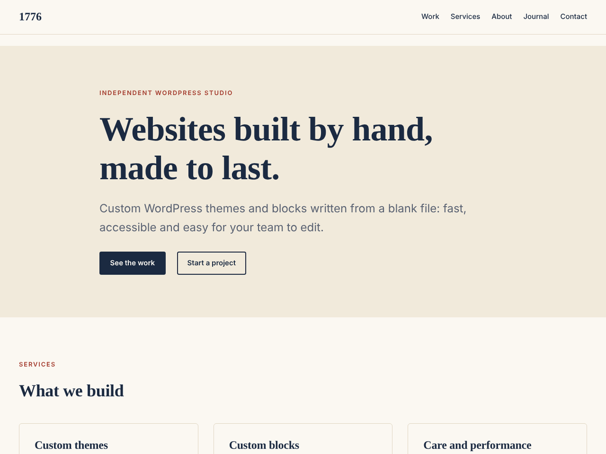

# 1776: a WordPress block theme, built from scratch

[](https://github.com/rselover/1776-wordpress-template/actions/workflows/lint.yml)

**[Open the live demo](https://playground.wordpress.net/?blueprint-url=https://rselover.github.io/1776-wordpress-template/blueprint.json)** · [Demo page](https://rselover.github.io/1776-wordpress-template/)



1776 is a WordPress theme for a small studio or consultancy: services, a portfolio, a blog and a contact form. It was written from a blank file, with no parent theme, starter theme, page builder or form plugin. The goal is code that a reviewer can open and follow.

## What's inside

| Area | Where | Notes |
| --- | --- | --- |
| Design tokens | `theme.json` | Colour palette, fluid type scale, spacing scale, element and block styles. Default WordPress presets are switched off so editors only see the brand palette. |
| Templates | `templates/`, `parts/` | 12 block templates, including custom ones for the Project post type and a "Landing page (no title)" page template. |
| Patterns | `patterns/*.php` | 9 patterns written in PHP so every string is translatable and every URL is escaped. Templates compose the home page from them. |
| Custom blocks | `blocks/` | 4 dynamic blocks, each with `block.json`, `render.php`, `index.js` and `style.css`. |
| Content model | `inc/post-types.php` | `Project` post type, `Project Type` taxonomy, typed and sanitized post meta exposed in REST, and a private `Message` post type for form submissions. |
| Meta box | `inc/meta-boxes.php` | Client, year and live URL, saved with nonce, autosave and capability checks. |
| Contact form | `inc/contact-form.php` | Plugin-free handler (details below). |
| Style variation | `styles/midnight.json` | Dark palette, selectable in the Site Editor. |
| Tooling | `phpcs.xml.dist`, `.github/workflows/` | WordPress Coding Standards and PHP 7.4+ compatibility checks on every push, plus the demo deploy. |

### Custom blocks

All four are **dynamic** blocks: they save only their settings, and `render.php` builds the HTML on every request. Markup can change later without "This block contains unexpected content" errors in old posts, and every value is escaped on output.

- **Project Grid** (`theme-1776/project-grid`): a grid of projects with count, columns, project type filter and an option to hide the current project. Uses `no_found_rows` and avoids `post__not_in` to keep the query cheap.
- **Project Details** (`theme-1776/project-details`): client, year, type and live link, read from block context so it works in templates and Query Loops.
- **Testimonial** (`theme-1776/testimonial`): quote, name and role, edited inline and stored as plain text.
- **Contact Form** (`theme-1776/contact-form`): the form markup, posting to the handler below.

The editor scripts are plain JavaScript (`wp.element.createElement`, no JSX), with hand-written `index.asset.php` files, so the theme installs straight from Git with no build step. On a larger project I would use `@wordpress/scripts` and JSX; the PHP side would not change.

### Contact form security

`inc/contact-form.php` posts to `admin-post.php`, so it works without JavaScript. In order, it:

1. verifies a nonce (CSRF),
2. checks a hidden honeypot field (bots are told "sent" and ignored),
3. rate-limits each visitor to 3 messages per 10 minutes, keyed on a hash of the IP so raw IPs are never stored,
4. validates and sanitizes name, email and message,
5. saves the message as a private **Message** post before emailing it, so a mail failure never loses a lead,
6. redirects back with a whitelisted status code (Post/Redirect/Get), using `wp_validate_redirect()` to block open redirects.

The recipient defaults to the site admin email and can be changed with the `theme_1776_contact_recipient` filter.

### Other details worth a look

- All PHP is namespaced (`Theme1776\...`), and slugs, meta keys and handles are prefixed (`t1776_`, `theme-1776`).
- `inc/enqueue.php` loads per-block CSS for core blocks only on pages that use them (`wp_enqueue_block_style()`).
- Accessibility: visible focus styles, labelled form fields, `role="alert"` on form errors, `prefers-reduced-motion` support, and decent colour contrast in both palettes.
- WordPress.org guidelines put post types in plugins so content survives a theme switch. They live in the theme here so the demo is a single install; `inc/post-types.php` and `inc/meta-boxes.php` are self-contained to make that move simple.

## File structure

```
├── functions.php          Loads the files in inc/
├── inc/                   PHP, one concern per file
├── blocks/                Custom blocks (block.json + render.php + index.js)
├── patterns/              PHP block patterns
├── templates/  parts/     Block templates and template parts
├── styles/                Style variations
├── assets/css/blocks/     Per-block CSS for core blocks
├── theme.json  style.css  Design tokens and theme header
└── demo/                  Playground blueprint, demo content and landing page (not in the theme zip)
```

## Live demo

The demo runs on [WordPress Playground](https://wordpress.org/playground/), which runs PHP and WordPress in the browser, hosted for free on GitHub Pages:

- `.github/workflows/demo.yml` builds the theme zip with `git archive` (dev files are excluded via `.gitattributes`) and publishes it with `demo/blueprint.json`, `demo/setup.php` and `demo/index.html` to GitHub Pages on every push to `main`.
- `demo/blueprint.json` tells Playground to install and activate the theme, then run `demo/setup.php`, which creates the pages, projects, posts and menu.

## Install on a real site

1. Download the zip from the [demo page](https://rselover.github.io/1776-wordpress-template/1776-wordpress-template.zip), or clone this repo into `wp-content/themes/1776-wordpress-template`.
2. Activate **1776** under Appearance → Themes. Requires WordPress 6.6+ and PHP 7.4+.
3. Add Projects, then create Services, About and Contact pages from the theme's patterns.

## Development

```bash
composer install     # WordPress Coding Standards + PHPCompatibility
composer lint        # phpcs
composer lint:fix    # phpcbf
```

To run it locally with Playground and the demo content (needs Node 20+). Edits to the theme show up on reload:

```bash
npx @wp-playground/cli server \
  --mount=.:/wordpress/wp-content/themes/1776-wordpress-template \
  --blueprint=demo/blueprint.local.json
```

## License

GPL-3.0-or-later. See [LICENSE](LICENSE).
